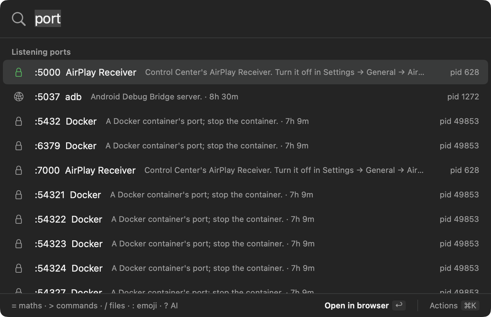

<div align="center">


# Nabız

**Your Mac's pulse — and your dev stack — in the menu bar.**

Free and open source. A native macOS menu bar app with a system monitor that fixes things in one tap, your AI limits
and an AI chat (Apple's on-device model, or your own Claude, Codex, Grok or Gemini), dev servers and ports, and a
launcher, clipboard, screenshots and Screen Studio–style recordings.

<a href="../../releases/latest"></a>


<a href="https://x.com/mehmetatakartal"></a>

```bash
brew tap matakartal/nabiz https://github.com/matakartal/nabiz && brew trust matakartal/nabiz && brew install --cask matakartal/nabiz/nabiz
```

[Features](#features) · [Install](#install) · [Use it from Claude Code](#use-it-from-claude-code-and-cursor) · [Privacy](#privacy) · [Türkçe](README.tr.md) · [简体中文](README.zh-CN.md)

<br>


</div>

<br>

## Why Nabız

<table>
<tr>
<td width="25%" valign="top"><b>Native and light</b><br>SwiftUI + AppKit, the system's own menu material and grid. Idle at 0–1% CPU.</td>
<td width="25%" valign="top"><b>Fixes, not just numbers</b><br>When memory runs out it says why and offers the one step that frees the most.</td>
<td width="25%" valign="top"><b>AI that can stay on your Mac</b><br>Apple's on-device model is free, private and works offline — or bring Claude, Codex, Grok or Gemini.</td>
<td width="25%" valign="top"><b>Open and private</b><br>No analytics, no account. Open source, so you can see exactly what it does.</td>
</tr>
</table>

## Built for people who ship with AI

You prompt, agents build, and your Mac quietly fills up. Nabız keeps up with how you work now:

- **Forgotten dev servers and port clashes:** every server an agent started, with its project and port — stop it in
  one click, or ask `:3000` who holds a port. AI apps can ask Nabız over **MCP** too, so Claude Code and Cursor reuse
  a running server instead of starting a second one.
- **Your AI limits before you hit them:** Claude, Codex and Gemini windows in the menu bar, with a warning when one
  burns fast — and another AI one click away in the chat.
- **The mess agents leave behind:** finished worktrees, build folders, idle `node_modules`, extra simulators — sized,
  listed and cleaned only after asking. Unpushed commits and projects show at a glance.
- **Ship and show it:** notarization finishes as a notification, screenshots get arrows and steps, and recordings come
  out launch-ready with smooth zooms — for your demo, README or post on X.
- **No context switching:** ask a quick question (⌃⌥A), dictate a prompt (⌃⌥D), keep notes over your editor (⌃⌥M) and
  find anything from the launcher (⌃⌥Space).

## Features

<table>
<tr>
<td width="44%"></td>
<td valign="top">

### A panel that tells you what to do

- **Menu bar:** CPU, RAM, GPU, network, disk, battery, an AI limit, a market price or an exchange rate — two lines
  or one.
- **Live meters** with a two-minute graph; memory pressure, swap, battery health, heat and security.
- **Suggestions with one-tap fixes:** shut down idle simulators, quit the biggest app, push forgotten commits, clear
  gigabytes of developer leftovers.
- **Weather** for your city — now, rain on the way, sunrise or sunset and the coming days — with no location
  permission; the temperature can sit in the menu bar too.
- **Top apps**, a week of **history**, **external display brightness**, **calendar** with one-click join,
  **Hyperliquid markets** and **exchange rates**.
- Sections fold to a one-line summary; hide crowded menu bar icons; optionally show in the Dock.

</td>
</tr>
</table>

<table>
<tr>
<td valign="top">

### AI chat — on your Mac or on your own subscriptions

- **Apple's on-device model** is the default: free, no account, nothing leaves the Mac, and it works offline
  (Apple Intelligence, macOS 26). It also names your chats and suggests your next message.
- **⌃⌥I** opens a chat window like the providers' own apps. Switch to Claude, Codex, Grok or Gemini through the
  CLIs you already use — each with its real models and thinking levels, on your own plan.
- **Web search** with sources for Claude, Codex and Grok — and no other tools, no files, no commands.
- Pinned chats, folders, search (⌘K), images and PDFs, side chats (⌥⌘S), quoting, branching, a queue while it
  writes, "Summarize and continue", and a ring that shows how full the chat is.
- **Quick questions** (⌃⌥A), your own AI commands on selected text, **dictation** (⌃⌥D) and **AI limits** with a
  warning before they run out. Chats are stored encrypted.

</td>
<td width="56%"></td>
</tr>
</table>

<table>
<tr>
<td width="56%"></td>
<td valign="top">

### Screenshots and recordings

- **⌃⌥S:** area, window or screen, then arrows, boxes, text, numbered steps, blur, spotlight, crop and a gradient
  frame. Copy the text in it, pin it over every app, drag it out.
- **⌃⌥R:** record the screen, a window or an area with sound and your camera. The editor draws a smooth pointer,
  rings each click and zooms where you clicked; add backgrounds, captions made on this Mac, cuts and speed-ups.
  Export MP4 up to 4K or GIF.

</td>
</tr>
</table>

<table>
<tr>
<td valign="top">

### A launcher for everything

**⌃⌥Space**, keyboard first, ⌘K for every action on a row.

- Apps, files, notes, emoji, Shortcuts, scripts and system commands.
- Maths, money and units: `20% of 150`, `100 usd`, `0.5 btc`, `5 km mi`, `tokyo`, `today + 30 days`.
- Quicklinks, snippets, clipboard history (⌃⌥V), sound output and Bluetooth, video links via yt-dlp.
- Your own shortcut or alias for any row.

</td>
<td width="56%"></td>
</tr>
</table>

<table>
<tr>
<td width="56%"></td>
<td valign="top">

### Made for developers

- **Ports:** `:3000` tells you who holds it and lets you stop or open it.
- **Dev servers** with their project and uptime — open one on your phone with a QR code.
- **Projects** with branch, changes and unpushed commits; open in your editor, start Claude Code, run scripts.
- **Docker**, **simulator** tools, careful **clean-up** that shows what it frees, and **notarization** in the panel.
- **MCP server:** Claude Code, Claude Desktop and Cursor read your Mac's status, ports and projects.
- Launcher answers: JWT, Unix time, hashes, UUIDs, colours, cron, HTTP codes, Base64.

</td>
</tr>
</table>

<table>
<tr>
<td valign="top">

### And the everyday tools

Pomodoro and focus mode (with website blocking), keep awake, timers, notes that float over every app (⌃⌥M), window
layouts, pick a colour, read text or QR on screen, speed test, password and UUID, eject disks, cache cleaners,
hidden files, desktop icons, schedules and a one-file backup.

Settings has a searchable sidebar in Turkish and English, and **What can it do?** lists every shortcut and tool.

</td>
<td width="34%"></td>
</tr>
</table>

## Install

**Homebrew:**

```bash
brew tap matakartal/nabiz https://github.com/matakartal/nabiz && brew trust matakartal/nabiz && brew install --cask matakartal/nabiz/nabiz
```

**Or download** `Nabiz-x.y.z.dmg` from [Releases](../../releases/latest), open it and drag Nabız to Applications.

Builds are universal (Apple silicon and Intel), signed with a Developer ID and notarized by Apple, so Nabız opens
without warnings. macOS 14 or later. A short welcome shows where things are, and new versions update themselves from
the panel's **Update** button.

## Use it from Claude Code and Cursor

Turn on Settings → MCP (one click adds it to Claude Code and Claude Desktop), or add it yourself:

```bash
claude mcp add --scope user nabiz -- /Applications/Nabiz.app/Contents/MacOS/Nabiz --mcp
```

Your agents can then see this Mac's status, the dev servers and ports already running (so they reuse a server
instead of starting a second one), your projects, Docker, AI limits, calendar and notes — and start timers, focus
mode or a screen recording.

## Shortcuts

| Keys | What | Keys | What |
| --- | --- | --- | --- |
| ⌃⌥Space | Launcher | ⌃⌥I | AI chat |
| ⌃⌥V | Clipboard history | ⌃⌥A | Ask AI |
| ⌃⌥M | Notes | ⌃⌥D | Dictation |
| ⌃⌥S | Screenshot | ⌃⌥R | Screen recording |

Every shortcut can be changed or turned off in Settings → Shortcuts, and any launcher row can get its own.

## Privacy

Everything about your Mac is measured locally. Nabız has no analytics and no account. It goes online only for:

| What | Where | When |
| --- | --- | --- |
| Exchange rates | [frankfurter.dev](https://frankfurter.dev) (ECB daily rates) | When rates are shown |
| Market prices | `api.hyperliquid.xyz` | When markets are shown or alerts are set |
| Weather | `open-meteo.com` — only the chosen city's coordinates | When the weather is shown |
| Updates | GitHub releases | Periodically |
| AI limits | Each provider's own usage endpoint, with the sign-in its CLI already keeps | Only for providers you turn on |
| AI chat | The provider you pick, through its own CLI | When you chat; Apple's on-device model never leaves the Mac |
| Your requests | Web search, yt-dlp, speed test | Only when you ask |

Nabız reads only your own user's processes and never asks for administrator rights. Some tools ask macOS once for
screen recording, Accessibility, the microphone, speech, the calendar or System Events. Clipboard history and AI
chats are encrypted on disk with a key in your Keychain; the MCP server listens on a socket only your user can open;
crash reports stay on your Mac until you choose to send one.

## Build

macOS 14 or later and Swift 6 (Xcode 16 or later).

```bash
./build.sh            # build/Nabiz.app, universal
./build.sh install    # also copies it to ~/Applications and opens it
./build.sh dmg        # also packages build/Nabiz-<version>.dmg
swift test            # unit tests
./release.sh publish  # test, sign, notarize, staple and publish the GitHub release
```

<details>
<summary><b>Development helpers</b></summary>

- `Nabiz --snapshot out.png [--dark]` renders the panel with live data. Add `--settings --page general`,
  `--launcher "100 usd"`, `--ai-window "question"`, `--shot image.png --seed` or `--help` for other windows, and
  `--chrome` for a real titled window. The screenshots here are made this way; `swift scripts/make-hero.swift`
  builds the cover image from them.
- `Nabiz --calc "5 km mi"` prints what the calculator would show.
- `Nabiz --mcp` runs the MCP server for AI apps.
- `swift scripts/make-icon.swift` regenerates the app icon.
- Signing for releases: `xcrun notarytool store-credentials nabiz` once, then `./release.sh publish`.

</details>

<details>
<summary><b>Project layout</b></summary>

| Path | What |
| --- | --- |
| `Sources/Nabiz/App.swift` | Status item, panel window, menus, snapshot renderer |
| `Sources/Nabiz/Views/` | Panel, launcher, AI chat, Settings, help, notes and welcome windows |
| `Sources/Nabiz/Monitor/` | CPU, memory, GPU, process, network, battery, simulator, dev server and Docker samplers |
| `Sources/Nabiz/Tools/` | Launcher, calculator, AI, clipboard, markets, rates, developer tools, MCP server |
| `Sources/Nabiz/Tools/Shot/`, `Tools/Rec/` | Screenshot editor and screen recorder |
| `Sources/Nabiz/Support/` | Settings keys, the `L("tr", "en")` helper, menu bar text, updates |
| `Sources/Nabiz/DesignSystem/Theme.swift` | Colours, type, spacing, menu grid |

Every user-facing string is written in both languages side by side: `L("Türkçe", "English")`.

</details>

Bug reports and ideas are welcome — see [CONTRIBUTING.md](CONTRIBUTING.md), the design rules in
[docs/DESIGN.md](docs/DESIGN.md) and [SECURITY.md](SECURITY.md).

## Author

Made by **Mehmet Ata Kartal** — follow [@mehmetatakartal on X](https://x.com/mehmetatakartal) for updates.

Nabız is free. If you trade crypto, signing up on [Bybit with my referral link](https://www.bybit.com/register?affiliate_id=971&group_id=971&group_type=1) supports its development
(it's a referral link; you pay nothing extra).

## License

Nabız is free software under the [GNU GPL v3 or later](LICENSE): use it, study it, change it and share it — and
anything you distribute that is based on it stays open under the GPL too. The name and icon are not part of the
licence; forks use their own (see [TRADEMARK.md](TRADEMARK.md)).

© 2026 Mehmet Ata Kartal.
