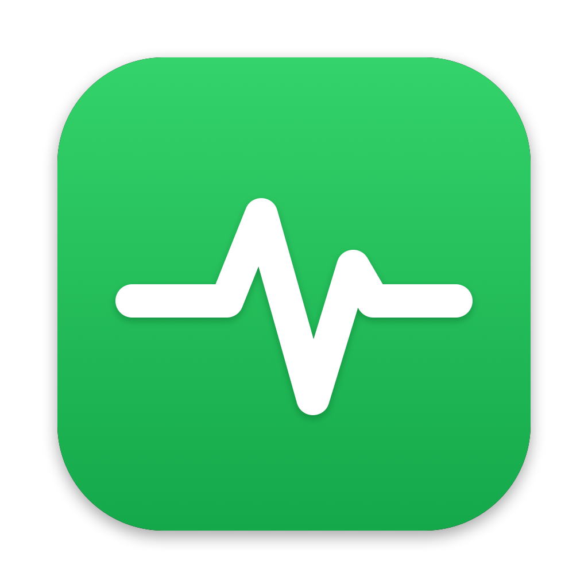
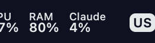
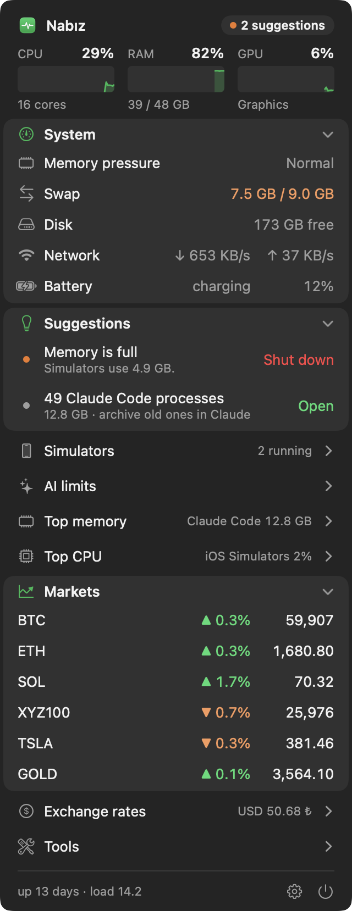
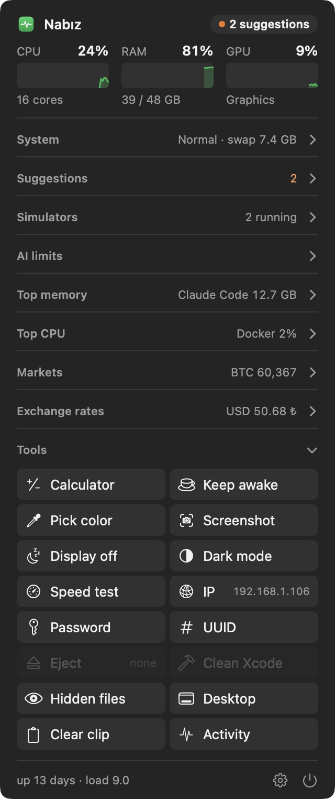
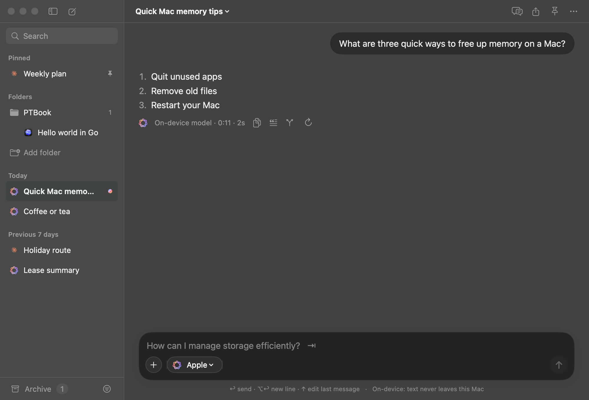
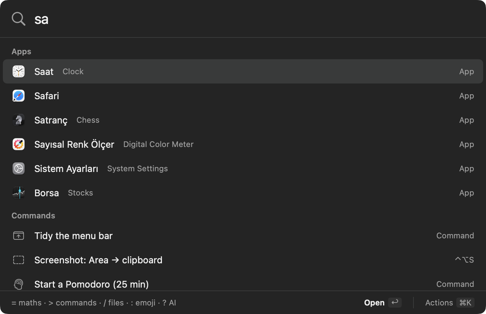
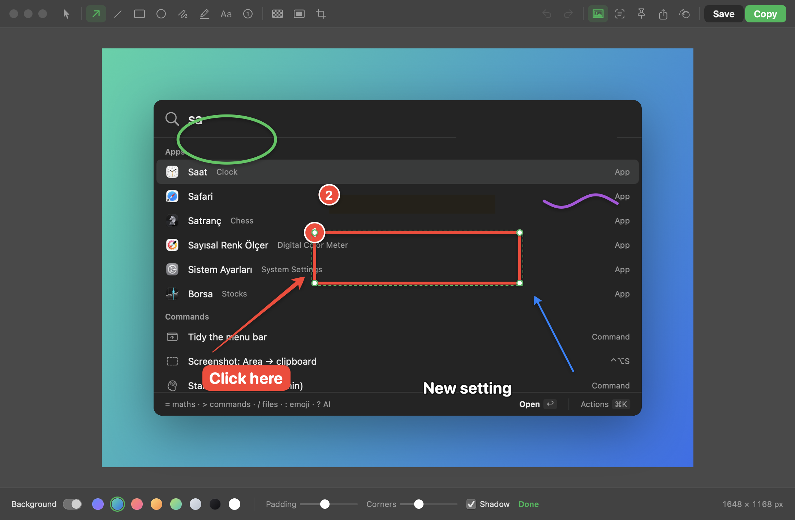
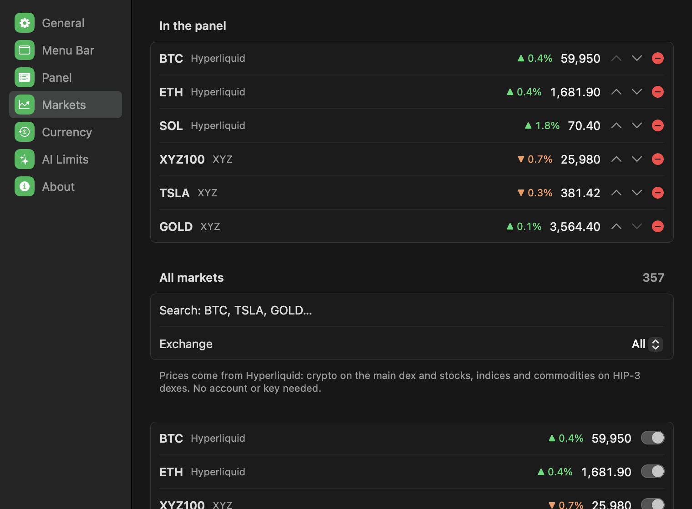

<p align="center"></p>

<h1 align="center">Nabız</h1>

<p align="center">Your Mac's pulse in the menu bar. A small, native, open-source system monitor for macOS, with the tools you reach for every day: a launcher, AI chat with your own subscriptions, screenshots and screen recordings, clipboard history, notes and developer tools.</p>

<p align="center"></p>

<p align="center">
  
  &nbsp;
  
</p>

<p align="center"></p>

<p align="center"></p>

<p align="center"></p>

<p align="center"></p>

<p align="center"></p>

<p align="center"><i>Türkçe aşağıda.</i></p>

## Install

Download the latest `Nabiz-x.y.z.dmg` from [Releases](../../releases), open it and drag Nabız to Applications. Releases are signed with a Developer ID and notarized by Apple, so Nabız opens without warnings. It needs macOS 14 or later and runs natively on Apple silicon and Intel.

On first launch, a short welcome explains where things are and offers to open Nabız at login. Later versions show an **Update** button in the panel that installs the new release and reopens Nabız.

## What it does

### Monitor

- **Menu bar:** the values you pick, two lines (a small label over a bold value) or one line: CPU, RAM, GPU, swap,
  network, free disk, battery, an AI limit, a market price, an exchange rate.
- **Live meters:** CPU, RAM and GPU with a two-minute graph; memory pressure, swap, disk, network, battery health,
  heat and security under them.
- **Suggestions with one-tap fixes:** when memory runs out Nabız says what is using it and offers the single step that
  frees the most (shut down the simulators, quit the biggest app). It also warns about a full disk, a low battery, a
  hot Mac, unpushed commits and gigabytes of developer leftovers.
- **Top apps:** the apps using the most memory and CPU, grouped by app. Hover to quit one or show it in Finder.
- **History:** CPU, RAM, GPU and AI usage for the last hour, day or week.
- **External displays:** a brightness slider for each display, and optionally the brightness keys work on the display
  under the pointer.
- **Hide crowded menu bar icons** (opt-in): ⌘-drag icons behind an arrow that folds them away.
- **Show in Dock** (opt-in): Nabız also sits in the Dock and ⌘⇥ with its own menus; clicking the icon opens the panel.

### AI

- **AI chat** (⌃⌥I) with your own subscriptions: Claude, Codex, Grok and Gemini through their CLIs on this Mac, or
  Apple's free on-device model. Each provider's models and thinking levels, pinned chats, folders, archive, search
  (⌘K), find in chat (⌘F), images and PDFs, side chats (⌥⌘S), quoting, a queue while it writes, branching from any
  answer, "Summarize and continue", and a ring that shows how full the chat is. Claude, Codex and Grok can search the
  web for current facts, with sources. Chats are stored encrypted.
- **Quick questions** (⌃⌥A or `?` in the launcher), ready-made tasks and your own AI commands for selected or copied
  text, and translation (`translate …`).
- **AI limits** (opt-in): Claude, ChatGPT/Codex and Gemini subscription windows with time to reset, in the panel and
  the menu bar, and a warning before a limit runs out.
- **Dictation** (⌃⌥D): speak, press again, and the words are typed where the cursor is; on-device when macOS has the
  language.
- **MCP server** (opt-in): Claude Code, Claude Desktop, Cursor and other AI apps can read this Mac's status, AI limits,
  calendar, notes, dev servers, ports, projects and Docker, and start timers, focus mode or screen recordings.

### Screenshots and recordings

- **Screenshots with markup** (⌃⌥S): area, window or screen; then arrows, lines, boxes, pen, highlighter, text,
  numbered steps, blur, spotlight and crop, plus a gradient frame. Copy the text in the image, pin it over every app,
  or drag it out as a file.
- **Screen recording** (⌃⌥R): the screen, a window or an area with sound and the camera. The editor draws a smooth,
  larger pointer, rings each click and zooms in where you clicked, with backgrounds, rounded corners, captions made on
  this Mac, cuts and speed-ups. Export MP4 (up to 4K) or GIF.

### Launcher (⌃⌥Space)

One field for everything, keyboard first (↑↓, ↩, ⌘K for every action on a row):

- apps, files, notes, emoji, your Shortcuts and scripts; system commands (lock, sleep, empty Trash, restart…)
- maths, money and units: `12*4`, `20% of 150`, `100 usd`, `5 bin tl`, `0.5 btc`, `5 km mi`, `tokyo`,
  `today + 30 days`
- sound and Bluetooth: `volume 40`, switch the output, connect AirPods
- quicklinks (`g words`, `gh`, `yt`…), snippets with `{date}` and `{clipboard}`, video links saved with yt-dlp
- your own shortcut or alias for any row (⌘K → "Set a shortcut…")
- developer answers: `:3000` or `port` (who holds a port, stop or open it), projects, JWT decode, Unix time,
  `sha256`, `uuid`, `case`, colours as HEX / RGB / SwiftUI, cron explained, `http 429`, `base64`, `brew`

### Developer tools

- **Dev servers:** every server you started (vite, next, wrangler…) with its project, ports and uptime; open, reveal or
  stop it, or open it on your phone with a QR code.
- **Projects:** every git repository in ~/Developer with its branch, changes and unpushed commits; open it in your
  editor or Terminal, start Claude Code there, run its scripts.
- **Docker:** one row per compose project; start, stop, restart, logs and a shell.
- **Simulators:** shut them down, a 9:41 status bar, dark mode, screenshots, recordings, test pushes.
- **Clean-up:** finished worktrees, build folders, extra iOS runtimes, DerivedData, unused simulators, idle
  node_modules, package caches, Docker volumes — each with its size, cleaned only after asking.
- **Notarization:** a running `notarytool submit` shows in the panel and Apple's answer arrives as a notification.

### Everyday tools

- **Tools grid:** AI chat, launcher, clipboard, notes, Pomodoro, focus, keep awake, timer, sleep timer, pick a colour,
  screenshot, record, read text or QR, video download, mic mute, dictate, display off, dark mode, speed test, IP,
  password and UUID, eject disks, Xcode and Rust caches, clean-up, hidden files, desktop icons.
- **Clipboard history** (⌃⌥V): text, links, colours, files and images; search, pin, ↩ pastes into the app you were
  in. Password managers' secret copies and apps you exclude are never recorded.
- **Notes** (⌃⌥M): notes that float above every app, with live Markdown and checklists; or Apple Notes if you prefer.
- **Pomodoro and focus mode:** the countdown in the menu bar; focus hides chat apps and can block websites.
- **Calendar:** today's meetings in the panel, a heads-up before each, one click to join the call.
- **Window layouts:** halves, thirds, centre and your own layouts and sets, each with a shortcut.
- **Markets (Hyperliquid) and price alerts:** crypto, stocks, indices and commodities, with repeating alerts.
- **Exchange rates:** your currencies in your main currency, with the daily change.
- **Schedules and backup:** weekly clean-ups and other tasks; one backup file for every setting, note and snippet.

### Look and settings

The panel uses the native menu material and the native menu grid: icons 16 pt in, text 40 pt in, values 16 pt from
the edge. Sections fold to a one-line summary. Accent colours, theme, typeface, density and panel order are yours to
pick. Settings has a searchable sidebar (in Turkish or English, without accents, with typos forgiven), and **What can
it do?** lists every shortcut and tool. Idle, Nabız uses about 0–1% CPU.

## Privacy

Everything about your Mac is measured locally, and Nabız has no analytics. It goes online only for:

- **Exchange rates:** the European Central Bank's daily rates from [frankfurter.dev](https://frankfurter.dev).
- **Market prices:** Hyperliquid's public info API (`api.hyperliquid.xyz`). No account involved.
- **Updates:** the latest release on GitHub.
- **AI limits:** only for providers you turn on, through that provider's own usage endpoint with the sign-in its
  official CLI already keeps on your Mac. Nabız never stores, refreshes or forwards that sign-in.
- **AI chat:** your messages go to the provider you pick through its own CLI; Apple's on-device model never leaves the
  Mac. Web search is used only by Claude, Codex and Grok, only when on, and they get no other tools.
- **Things you ask for:** web searches, video downloads (yt-dlp) and the speed test.

Nabız reads only your own user's processes and never asks for administrator rights. Some tools ask macOS once:
screen recording (screenshots, recordings), Accessibility (pasting, window layouts), microphone and speech
(dictation), calendar, and control of System Events (dark mode). The clipboard history and AI chats are encrypted on
disk with a key kept in your Keychain. The MCP server listens on a socket only your user can open. Crash reports stay
on your Mac until you choose to send one.

## Build

You need macOS 14 or later and Swift 6 (Xcode 16 or later).

```bash
./build.sh            # build/Nabiz.app, universal
./build.sh install    # also copies it to ~/Applications and opens it
./build.sh dmg        # also packages build/Nabiz-<version>.dmg
```

Run `swift test` for the unit tests. Builds are ad-hoc signed by default; `./release.sh publish` runs the tests,
signs with your Developer ID, notarizes, staples and publishes the GitHub release with notes from CHANGELOG.md:

```bash
xcrun notarytool store-credentials nabiz        # once
./release.sh publish
```

The GitHub workflow builds the universal app and the DMG on every push and pull request. To regenerate the app icon,
run `swift scripts/make-icon.swift`.

Development helpers:

- `Nabiz --snapshot out.png [--dark]` renders the panel with live data; add `--settings --page general`,
  `--launcher "100 usd"`, `--ai-window "question"`, `--shot image.png --seed` or `--help` for other windows, and
  `--chrome` for a real titled window. The images above are made this way.
- `Nabiz --calc "5 km mi"` prints what the calculator would show.
- `Nabiz --mcp` runs the MCP server for AI apps.

## Project layout

| Path | What |
| --- | --- |
| `Sources/Nabiz/App.swift` | Status item, panel window, menus, snapshot renderer |
| `Sources/Nabiz/Views/` | Panel, launcher, AI chat, Settings, help, notes and welcome windows |
| `Sources/Nabiz/Monitor/` | CPU, memory, GPU, process, network, battery, simulator, dev server and Docker samplers |
| `Sources/Nabiz/Tools/` | Launcher, calculator, AI, clipboard, markets, rates, developer tools, MCP server |
| `Sources/Nabiz/Tools/Shot/`, `Tools/Rec/` | Screenshot editor and screen recorder |
| `Sources/Nabiz/Support/` | Settings keys, the `L("tr", "en")` helper, menu bar text, updates |
| `Sources/Nabiz/DesignSystem/Theme.swift` | Colours, type, spacing, menu grid |

Every user-facing string is written in both languages, side by side: `L("Türkçe", "English")`.

## License

MIT. See [LICENSE](LICENSE).

---

## Türkçe

Nabız, Mac'inin nabzını menü çubuğunda tutan küçük, yerel ve açık kaynak bir sistem izleyicisi. Yanında her gün
işine yarayacak araçlar gelir: başlatıcı, kendi aboneliklerinle AI sohbeti, ekran görüntüsü ve ekran kaydı, pano
geçmişi, notlar ve geliştirici araçları.

**Kurulum:** [Releases](../../releases) sayfasından `Nabiz-x.y.z.dmg` dosyasını indir, aç ve Nabız'ı Programlar
klasörüne sürükle. Sürümler imzalı ve Apple onaylıdır, uyarısız açılır. macOS 14 veya üstü gerekir; Apple Silicon ve
Intel'de çalışır.

**Neler var:**

- **İzleme:** menü çubuğunda seçtiğin değerler (CPU, RAM, GPU, ağ, disk, pil, AI limiti, piyasa, döviz); canlı
  grafikler; bellek dolunca tek tuşla çözüm; en çok kaynak kullanan uygulamalar; geçmiş; harici ekran parlaklığı;
  kalabalık menü çubuğu simgelerini gizleme; istersen Dock'ta da görünme.
- **AI sohbet (⌃⌥I):** Claude, Codex, Grok, Gemini ya da Apple'ın ücretsiz cihaz içi modeli. Sabitlenmiş sohbetler,
  klasörler, arama (⌘K), görsel ve PDF, yan sohbet, alıntı, dallanma, özetle ve sürdür. Claude, Codex ve Grok
  gerekince web'de arar ve kaynak gösterir. Sohbetler şifreli saklanır.
- **Hızlı soru (⌃⌥A), dikte (⌃⌥D), AI limitleri ve MCP sunucusu:** AI uygulamaları Mac'in durumunu, portları,
  projeleri ve Docker'ı okuyabilir.
- **Ekran görüntüsü (⌃⌥S):** ok, kutu, yazı, numara, bulanıklaştırma ve çerçeveyle düzenle.
- **Ekran kaydı (⌃⌥R):** tıkladığın yere yakınlaşan, imleci yumuşatan, altyazıyı Mac'te çıkaran editör; MP4 ya da GIF.
- **Başlatıcı (⌃⌥Boşluk):** uygulama, dosya, komut, hesap ve çeviri (`100 usd`), ses ve Bluetooth, parçacıklar,
  kısayol ve takma ad, geliştirici cevapları (`:3000`, JWT, Unix zamanı, renk, cron…).
- **Geliştirici araçları:** çalışan sunucular (telefonda QR ile aç), projeler, Docker, simülatörler, sorarak yapılan
  temizlik, notarize takibi.
- **Günlük araçlar:** pano geçmişi (⌃⌥V), notlar (⌃⌥M), Pomodoro ve odak modu, takvim, pencere düzenleri, piyasalar ve
  fiyat alarmları, döviz, zamanlanmış görevler ve yedek.
- **Ayarlar:** aranabilir kenar çubuğu; Türkçe ve İngilizce.

**Gizlilik:** Mac'inle ilgili her şey Mac'in içinde ölçülür; analitik yoktur. İnternete yalnızca döviz kurları,
Hyperliquid fiyatları, güncelleme kontrolü, açtığın AI sağlayıcılarının kendi sunucuları ve senin istediğin işler
(web araması, video indirme, hız testi) için çıkar. Apple'ın cihaz içi modeli Mac'ten hiç çıkmaz.
