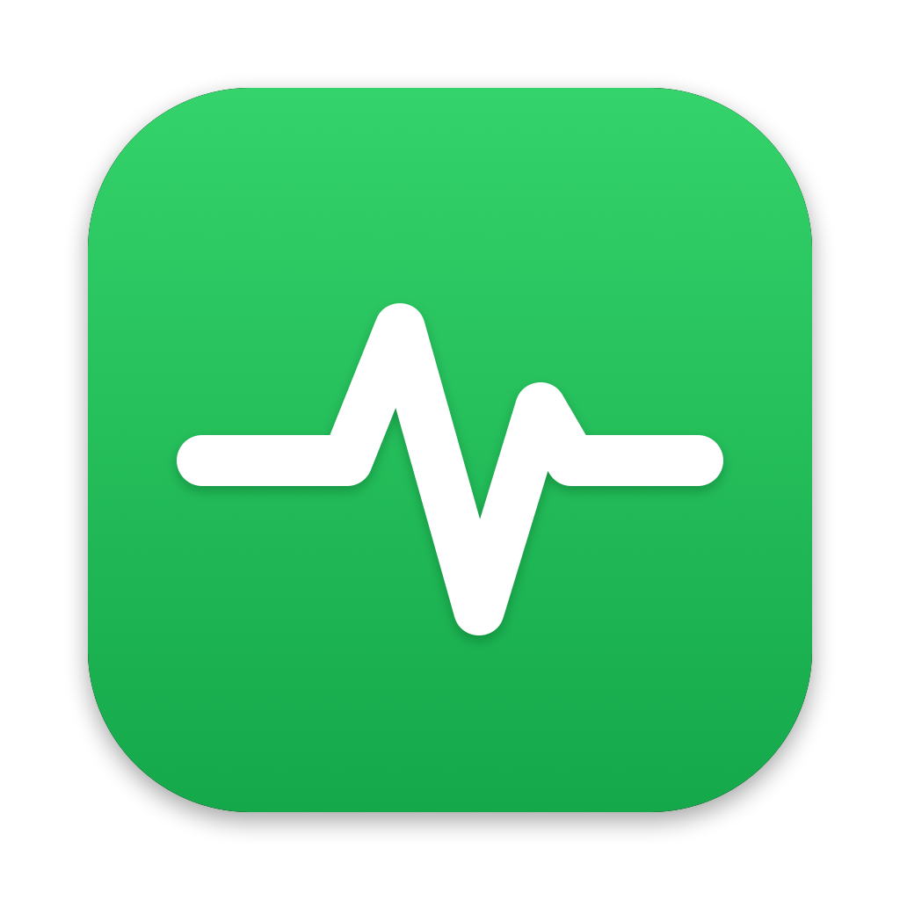
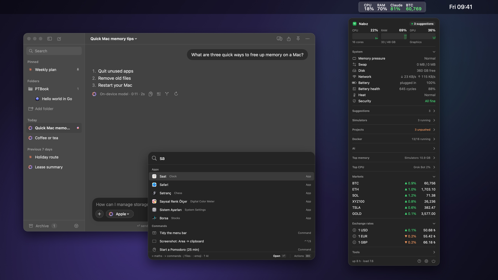
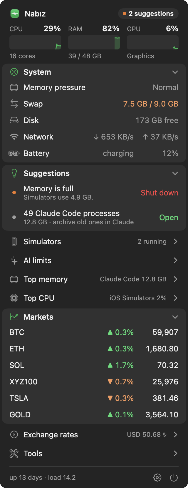
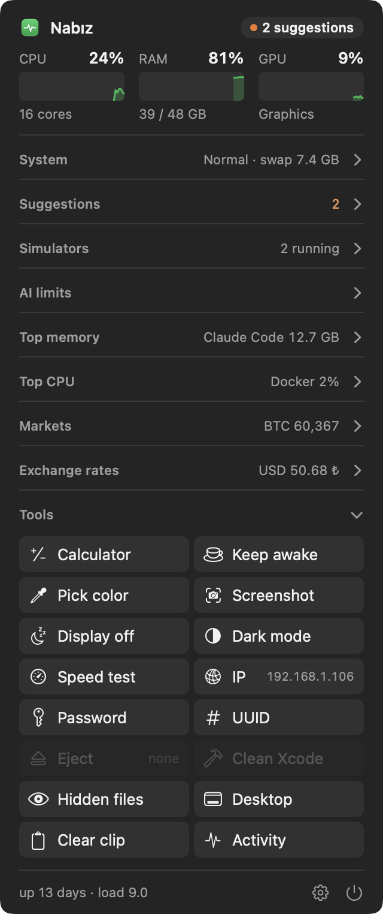

# Nabız

**Mac'inin nabzı menü çubuğunda — gün boyu elinin altında olan araçlarla.**

macOS için küçük, yerel ve ücretsiz bir menü çubuğu uygulaması; kaynak kodu okunmaya açık: tek tuşla çözüm sunan sistem izleyici, kendi
aboneliklerinle AI sohbeti, başlatıcı, ekran görüntüsü ve ekran kaydı, geliştirici araçları.

[English](README.md)

 

## Neler var

- **Panel:** menü çubuğunda CPU, RAM, GPU, ağ, disk, pil, AI limiti, piyasa ya da döviz. Canlı grafikler. Bellek
  dolunca neyin doldurduğunu söyler ve en çok yer açan adımı tek tuşla yapar. Geçmiş, harici ekran parlaklığı,
  takvim, Hyperliquid piyasaları ve döviz kurları da burada. İstersen Dock'ta da görünür.
- **AI sohbet (⌃⌥I):** Claude, Codex, Grok, Gemini ya da Apple'ın ücretsiz cihaz içi modeli. Claude, Codex ve Grok
  gerekince web'de arar ve kaynak gösterir. Sabitlenmiş sohbetler, klasörler, arama (⌘K), görsel ve PDF, yan sohbet,
  alıntı, dallanma. Sohbetler şifreli saklanır. Hızlı soru (⌃⌥A), dikte (⌃⌥D) ve AI limitleri.
- **Ekran görüntüsü (⌃⌥S):** ok, kutu, yazı, numara, bulanıklaştırma, kırpma ve renkli çerçeve.
- **Ekran kaydı (⌃⌥R):** imleci yumuşatan, tıkladığın yere yakınlaşan, altyazıyı Mac'te çıkaran editör; 4K'ya kadar
  MP4 ya da GIF.
- **Başlatıcı (⌃⌥Boşluk):** uygulama, dosya, komut, hesap ve çeviri (`100 usd`, `5 bin tl`), parçacıklar, pano
  geçmişi (⌃⌥V), ses ve Bluetooth, her satıra kendi kısayolun.
- **Geliştiriciler için:** portlar (`:3000`), çalışan sunucular (telefonda QR ile aç), projeler ve gönderilmemiş
  commit'ler, Docker, simülatörler, sorarak yapılan temizlik, notarize takibi ve MCP sunucusu.
- **Günlük araçlar:** Pomodoro ve odak modu, uyanık kal, zamanlayıcı, notlar (⌃⌥M), pencere düzenleri, renk al,
  ekrandan metin oku, hız testi, şifre üret, zamanlanmış görevler ve yedek.

  
  &nbsp;
  

## Kurulum

1. [Releases](../../releases/latest) sayfasından `Nabiz-x.y.z.dmg` dosyasını indir.
2. Aç ve Nabız'ı Programlar klasörüne sürükle.
3. Nabız'ı aç; kısa bir karşılama ekranı her şeyin yerini gösterir.

Sürümler imzalı ve Apple onaylıdır, uyarısız açılır. Yeni sürüm çıkınca panelde **Güncelle** düğmesi belirir.
macOS 14 veya üstü gerekir; Apple Silicon ve Intel'de çalışır.

## Gizlilik

Mac'inle ilgili her şey Mac'in içinde ölçülür; analitik ve hesap yoktur. İnternete yalnızca şunlar için çıkar:
döviz kurları, Hyperliquid fiyatları, güncelleme kontrolü, açtığın AI sağlayıcılarının kendi sunucuları ve senin
istediğin işler (web araması, video indirme, hız testi). Apple'ın cihaz içi modeli Mac'ten hiç çıkmaz. Pano geçmişi
ve AI sohbetleri diskte şifrelidir.

## Lisans

Nabız **kaynağı görülebilir, ama açık kaynak değildir.** Kodu okuyabilir ve resmi sürümleri ücretsiz kullanabilirsin;
yazılı izin olmadan kodu ya da bir parçasını kopyalayamaz, değiştiremez, başka projede kullanamaz, derleyemez ve
dağıtamazsın. Bkz. [LICENSE](LICENSE).

© 2026 Mehmet Ata Kartal. Tüm hakları saklıdır. Kodu farklı kelimelerle yeniden yazmak ya da başka dile çevirmek de
kopyalama sayılır; AI ajanları için kurallar [AGENTS.md](AGENTS.md) dosyasında.
