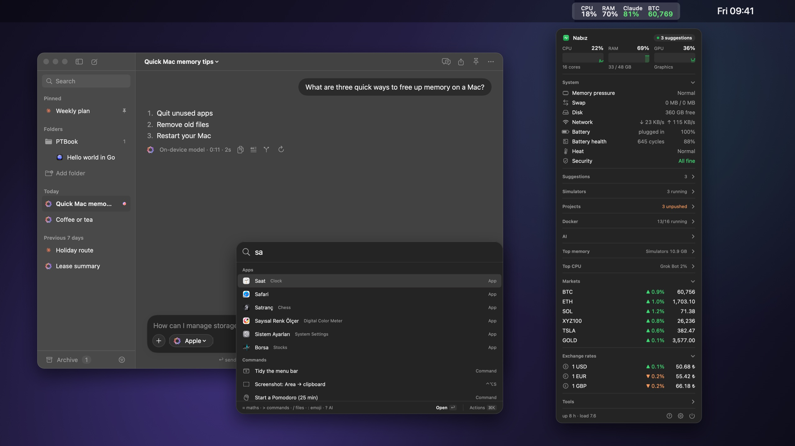

<div align="center">


# Nabız

**把 Mac 的脉搏和你的开发环境放进菜单栏。**

免费、开源的原生 macOS 菜单栏应用：一键解决问题的系统监视器、AI 用量限额与 AI 对话（Apple 设备端模型，或你自己的
Claude、Codex、Grok、Gemini 订阅）、开发服务器与端口、启动器、剪贴板历史、截图标注，以及 Screen Studio 风格的录屏。

<a href="../../releases/latest"></a>

[English](README.md) · [Türkçe](README.tr.md)

<br>



</div>

## 功能

- **面板：** 菜单栏显示 CPU、内存、GPU、网络、磁盘、电池、AI 限额、行情或汇率。内存不足时告诉你原因，并一键执行
  释放最多内存的那一步。还有历史记录、外接显示器亮度、日历、天气（无需定位权限）、Hyperliquid 行情和汇率。
- **AI 对话（⌃⌥I）：** 默认使用 Apple 设备端模型——免费、无需账号、数据不离开 Mac、离线可用（Apple Intelligence，
  macOS 26）。也可切换到 Claude、Codex、Grok 或 Gemini；Claude、Codex 和 Grok 可以联网搜索并附上来源。
- **为 AI 时代的开发者而做：** 查看并一键停止被遗忘的开发服务器，输入 `:3000` 查看谁占用了端口；Claude Code 和
  Cursor 可以通过 **MCP** 读取这些信息，复用已在运行的服务器。在用完之前看到 Claude、Codex、Gemini 的用量限额。
  清理代理留下的 worktree、构建目录、闲置的 `node_modules` 和多余的模拟器——列出大小，询问后才删除。
- **截图（⌃⌥S）与录屏（⌃⌥R）：** 箭头、方框、文字、步骤编号、模糊和边框；录屏会平滑指针并在点击处放大，可导出
  4K MP4 或 GIF。
- **启动器（⌃⌥Space）：** 应用、文件、命令、计算与换算、剪贴板历史（⌃⌥V）、代码片段、为任意一行设置快捷键。
- **日常工具：** 番茄钟与专注模式、保持唤醒、计时器、浮动笔记（⌃⌥M）、窗口布局、取色、屏幕文字识别、网速测试等。

## 安装

```bash
brew tap matakartal/nabiz https://github.com/matakartal/nabiz && brew install --cask matakartal/nabiz/nabiz
```

或从 [Releases](../../releases/latest) 下载 `Nabiz-x.y.z.dmg`，拖入“应用程序”文件夹。已签名并经 Apple 公证，
支持 Apple 芯片和 Intel，需要 macOS 14 或更高版本。界面目前提供英语和土耳其语。

## 隐私

所有关于你 Mac 的数据都在本机测量，没有统计分析，也不需要账号。只有汇率、行情、天气（仅城市坐标）、更新检查、
你开启的 AI 服务商，以及你主动发起的操作（网页搜索、视频下载、网速测试）才会联网。

## 许可

[GNU GPL v3 或更高版本](LICENSE)。名称和图标不在许可范围内，派生版本请使用自己的名称（见
[TRADEMARK.md](TRADEMARK.md)）。© 2026 Mehmet Ata Kartal · [X 上关注 @mehmetatakartal](https://x.com/mehmetatakartal)
